<div align="center">


<picture>
  <source media="(prefers-color-scheme: dark)" srcset="./assets/friday-agent.svg">
  
</picture>

<a href="https://git.io/typing-svg">
  
</a>

[](https://www.linkedin.com/in/veer-bajpai/)
[](mailto:bajpai.veer01@gmail.com)
[](https://github.com/veer-bajpai)


</div>

## `01 // ABOUT`

Backend Engineer building Python data pipelines, REST APIs, and AI agents. At **BisViews**, I run a Python ETL and web scraping pipeline that ingests multi-source data, then cleans, deduplicates, validates, and geocodes it. At **Micro1 Inc.**, I built a FastAPI authentication service and a 523-test Pytest suite.

Strong in **Python, SQL, data modeling, Git, Docker, CI/CD, and testing**. I use LLM APIs and AI tools such as Claude, Cursor, Gemini, and Copilot daily, with Slack-based remote collaboration.

```text
LOCATION  Chandigarh, India / Remote
FOCUS     Backend systems  |  Data engineering  |  Applied AI
STATUS    Open to Backend, Data Engineering, and AI Engineering roles
```

## `02 // TOOLCHAIN`

### Languages & Backend

<p align="center">
  
</p>

### Frontend & AI

<p align="center">
  
</p>

### DevOps, Testing & Collaboration

<p align="center">
  
</p>

<p align="center">
  
  
  
  
  
  
  
  
  
  
  
  
  
  
  
</p>

## `03 // EXPERIENCE`

### BisViews · Data Engineer Intern
`Oct 2026 – Present` · Remote

- Built a Python ETL and web scraping pipeline for franchise data across France, Italy, Brazil, and South Africa.
- Ingested multi-source records into a 22-field schema with cleaning, deduplication, validation, and geocoding.
- Deduplicated by brand, website, address, and place ID; validated records against required fields and a category taxonomy.
- Added Google Places and Nominatim geocoding with confidence scores for manual review.
- Split output into **Cleaned** and **Flagged** datasets with evidence-backed audit trails and reconciliation.
- Added Slack webhook alerts, retries, logging, and end-to-end reconciliation for run monitoring.

**Stack:** `Python` `Pandas` `Web Scraping` `REST APIs` `Google Places` `Nominatim` `Slack` `Git`

### Micro1 Inc. · Software Engineer Intern
`Apr 2025 – Sep 2025` · Remote

- Developed a production-ready FastAPI authentication and authorization service.
- Implemented JWT access control, role-based permissions, and REST API validation.
- Built Pytest suites for REST APIs and PostgreSQL covering **523 test cases**: integration, system, and regression.
- Shipped through Git branching, pull requests, code review, and Linux-based validation.

**Stack:** `Python` `FastAPI` `REST APIs` `JWT` `PostgreSQL` `SQL` `Pytest` `Postman` `Linux` `Git`

## `04 // SELECTED PROJECTS`

| Project | What it does | Tech |
|---|---|---|
| **[RepoPilot](https://github.com/veer-bajpai/Repo.Pilot-AI-Code-Agent)** · [Live Demo](https://repo-pilot-ai-code-agent.onrender.com/) | Sandboxed AI code agent that searches, edits, tests, and diffs code with human approval controls. **199/199 tests passed**; rejected edits were blocked safely. | Python, FastAPI, Gemini, BM25, Docker, JavaScript, Claude, Cursor |
| **[EventForge](https://github.com/veer-bajpai/Event.Forge-Multi-Tenant-Event-Management-Platform)** · [Live Demo](https://eventforge-o7yt.onrender.com/) | Multi-organizer event platform with PostgreSQL data modeling, REST APIs, JWT/RBAC login, and concurrency-safe bookings. Scale-tested at 600 concurrent bookings with zero oversold seats. | Python, FastAPI, PostgreSQL, SQL, Redis, Docker, JWT, RBAC |
| **FRIDAY** · [GitHub](https://github.com/veer-bajpai) | Local-first RAG workspace with 10 REST endpoints, streaming chat, document ingestion, chunking, embeddings, retrieval, grounded citations, and SQLite persistence. | Python, FastAPI, Pydantic, SQLite, RAG, Ollama, Next.js, TypeScript, Docker, GitHub Actions |

## `05 // EDUCATION`

**Chandigarh University** · Bachelor of Technology in Computer Science and Engineering

`Aug 2022 – May 2026` · Punjab, India · **CGPA: 7.5/10** · Dean's top 10%

Relevant coursework: Data Structures, Algorithms, Operating Systems, Computer Architecture, and OOP.

## `06 // ACHIEVEMENTS`

- 🏆 **3rd place among 20 teams** at HACKOVERFLOW 5.0, National Institute of Technology Durgapur.
- 🧩 **783rd of 21,000+** in LeetCode Biweekly Contest 96.
- 🧩 **557th of 4,000+** in CodeChef Starters 76.
- 🎓 **AIR 104** in the National Talent Search Examination (NTSE), 2022.

## `07 // CERTIFICATIONS`

| Certification | Issuer | Year |
|---|---|---:|
| Introduction to Linux (LFS101x) | The Linux Foundation | 2026 |
| Operating Systems | NPTEL (IIT) | 2025 |

## `08 // CORE COMPETENCIES`

```yaml
languages:
  Python: advanced
  SQL: advanced
  Bash: advanced
  C++: practiced

backend:
  - FastAPI
  - REST APIs
  - API integration
  - JWT and RBAC authentication
  - PostgreSQL
  - Redis
  - Data modeling

data_engineering:
  - ETL and web scraping
  - Data cleaning
  - Deduplication
  - Validation
  - Geocoding
  - End-to-end reconciliation

ai:
  - Gemini and Ollama
  - AI agents
  - RAG
  - Embeddings
  - Claude, Cursor, Copilot

devops:
  - Git
  - Docker
  - GitHub Actions
  - Render
  - AWS
  - Linux

testing:
  - Pytest
  - Postman
  - API testing
  - Integration testing
  - Regression testing
  - Scale testing
  - GDB
  - Valgrind
```

## `09 // GITHUB SIGNAL`

<div align="center">


</div>

## `10 // CONTRIBUTION TRACE`

<div align="center">


</div>

---

<div align="center">

[](https://www.linkedin.com/in/veer-bajpai/)
[](mailto:bajpai.veer01@gmail.com)
[](https://github.com/veer-bajpai)


</div>
